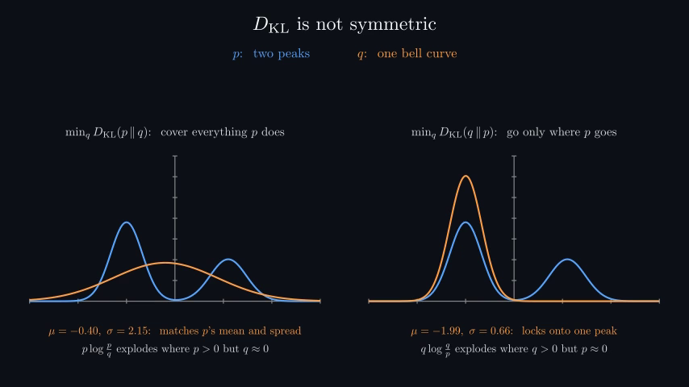
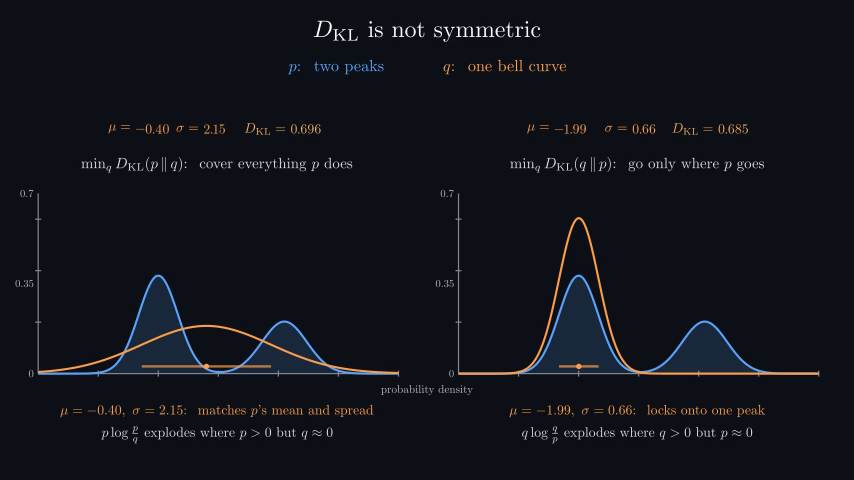
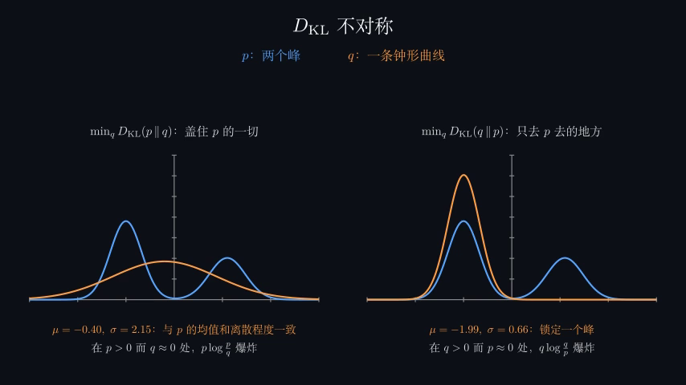
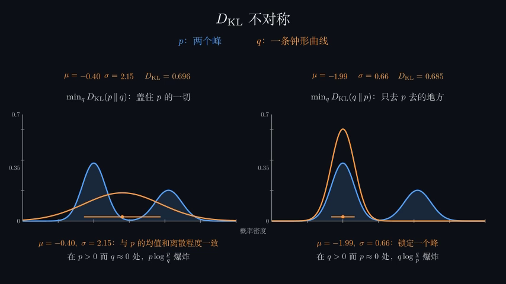

# AI, Built cloud QA progress — 31 October 2026

**Production approval remains pending for all 31 parts.** This is an incremental checkpoint on Part 1,
not completion of the requested full-series QA. Work proceeds in part order. Parts 2–31 have inventory/static
checks only; their rendered visuals, motion, narration and playback have not been reviewed in this cloud task.

Baseline: `af170318c179bfb56fa28aafe73477c56f5b80d8`. Branch: `qa/ai-series-cloud-20261031`.
The checkout is `/workspace/explainer-videos`; the unrelated mounted repository was left untouched.
No repository `AGENTS.md` or `.agents/skills/SKILL.md` exists. Read `CLAUDE.md`, `videos/ai/LECTURE_GUIDE.md`,
`SYLLABUS.md`, and the Part 26 reference conventions.

## Scope and persistent checklist

The [inventory](ai-built-20261031-inventory.md) and [machine-readable inventory](ai-built-20261031-inventory.json)
list all 31 parts, all 553 chapters, both languages (1,106 cases), source hashes, and remaining checks per item.
Their cache counts are an explicitly dated, non-atomic existence snapshot, not QA evidence.

The source-based narration estimate is 27.23 hours English, roughly 54.45 hours for one bilingual playback pass.
This excludes model computation, rendering, repeated repair passes and listening. The documented CPU narration
fallback takes 10–30 times real time; no narration server has been started in this environment. Part 26's 63.5-minute
source estimate exceeds the stated 60-minute target and requires measured pacing review.

## Verified changes

- QA tools report warning-bearing renders as `needs-review`, preserve crash/motion mode, and detect source/input
  changes. Audio QA persists missing/stale capture cases, rejects stale narration, and aggregates signal failures.
  Reports separate endpoint, sampled visual, motion-render and audio coverage; full playback/listening stays pending.
- Part 1's guessing-text wrapper preserves trailing/repeated whitespace instead of crashing or misaligning counts.
- Failed/empty book downloads cannot be published as completed cached source texts. HTTP errors do not get cached
  as HTML books. Language-model partial results are keyed by the actual passage and model/paragraph configuration.
- Shared Chinese captions preserve uniquely identifiable reordered numbers when measurements change. The actual
  rebuilt corpus count exposed this problem. Regression covers 161 AI and 17 Analysis reordered numeric templates,
  plus ambiguous repeated-value and existing same-order behavior.
- KL mode covering/seeking uses a shared density scale without clipped peaks, shaded target distributions,
  synchronized mean/spread/KL readouts and mean±standard-deviation markers. Semantic colors remain consistent.
- Mutual information no longer aborts because a hoped-for tail-to-noise ratio fails on revised books. Lag-specific
  marginals, active-alphabet bias corrections, signed estimates and matched shuffled controls are retained.
  The picture labels a descriptive fit, discloses nonpositive omissions and finite-sample limitations, and avoids
  extrapolation or an unqualified universal Markov-model claim.

## Before/after visual evidence

These are actual decoded frames from **only `CrossEntropy.asymmetry()`**, not full chapter or part approval.
Source/input hashes, frame times, decode and dead-air scan results are in [provenance](evidence/ai1-kl/provenance.json).
All four real silent 480p15 clips fully decode. English duration: 68.53 seconds each; Chinese: 72.33 seconds each.
Blank/sparse runs of at least 1.5 seconds: zero in each clip. Both after contact sheets (24 sampled frames each)
and endpoint comparisons were inspected; full visual playback and narrated listening remain pending.

| | Before | After |
|---|---|---|
| English |  |  |
| Chinese |  |  |

The local interactive review is `renders/qa/ai1-kl-comparison/index.html`; it links the four silent MP4s,
contact sheets and source/input provenance. Generated movies/caches remain ignored, consistent with repository policy.
Additional MI evidence and final chapter cases are being rendered; see the live local index below.

## Part 1 chapter coverage at this checkpoint

These are **endpoint runtime/layout checks**; a `passed` label does not claim full animation/playback QA.
Earlier-source/data records remain visible and must be rerun. The initial cache-only pass stopped when numerical
computation began; its incomplete records are not a sign-off. Final passes cover only completed immutable inputs.

| Chapter | English endpoint | Chinese endpoint |
|---|---|---|
| Hook | missing-data (earlier source/data) | not attempted |
| Probability | passed | not attempted |
| Surprise | passed | not attempted |
| Entropy | passed | not attempted |
| Prefix | passed | not attempted |
| Huffman | passed | not attempted |
| Typical | needs-review (earlier source/data) | not attempted |
| CrossEntropy | passed (earlier source/data) | not attempted |
| Arithmetic | needs-review (earlier source/data) | not attempted |
| Counting | missing-data (earlier source/data) | not attempted |
| Shannon1951 | missing-data (earlier source/data) | not attempted |
| Likelihood | missing-data (earlier source/data) | not attempted |
| Information | missing-data (earlier source/data) | not attempted |
| Knowledge | missing-data (earlier source/data) | not attempted |
| Units | missing-data (earlier source/data) | not attempted |
| Scoreboard | not attempted | not attempted |
| Outro | not attempted | not attempted |

- [x] Obtain separate checkout and isolated branch; inventory all parts; inspect production instructions.
- [x] Build an isolated Python 3.12/Manim 0.22 runtime; rebuild the documented book corpus and counting experiments.
- [x] Exercise numerical, cache, translation, QA-status and geometry regressions; compile all AI/shared/tool sources.
- [x] Inspect early chapter endpoint contact sheets and scoped KL before/after visual evidence.
- [ ] Finish all 17 Part 1 endpoint checks in both languages; resolve each warning and inspect updated sheets.
- [ ] Finish full silent motion renders, inspect intermediate animation and continuous playback, scan dead air.
- [ ] Finish pretrained-model results required by Hook, Knowledge, Units, Scoreboard and Outro.
- [ ] Start the documented local narration server; synthesize, listen and verify narration/visual synchronization.
- [ ] Build current narrated production cuts; measure duration, decode, verify markers/subtitles and final-resolution layout.
- [ ] Complete Parts 2–31 sequentially, then regress shared changes across rendered outputs of every part.

## Local evidence, active computation and next item

- Final chapter evidence/index: `renders/qa/series/index.html`; each case retains `result.json`, log, frames,
  contact sheet, source fingerprint and input signatures. Review records are bound to the inspected sheet hash.
- Model computation log: `renders/qa/ai1-model-compute.log`; the benchmark stores completed model rows in
  `.cache/ai1/lms.partial.json`. It is running on CPU with two threads. No synthetic substitutes are used.
- First completed pretrained row: GPT-2 small, 1.166 bits/character on the real passage; full scoreboard is pending.
- Counting logs: `renders/qa/ai1-compute.log`, `ai1-counting-compute.log`, `ai1-raw-compute.log`.
  A hoped-result MI assertion failed during the second batch; it was diagnosed and replaced with measured checks.
- Runtime activation: `source /workspace/runtime/activate.sh`. Manim/dvisvgm/Chinese TeX dependencies were installed
  under `/workspace/runtime`, without changing system files or the unrelated checkout.
- Next sequential work: finish Part 1 final English/Chinese endpoint passes, then motion passes for completed-data
  chapters. Defer the five model-dependent chapters until their data is atomically complete. Then narration and
  production review; proceed to Part 2 only after Part 1's outstanding coverage is explicit.

No web player application was found in this video-source repository. Responsive/player behavior in an external
hosting application is untested. Local decoded videos verify file integrity, not every browser/player.
No merge, deployment, paid service, new credential, or desktop execution was used.

Checkpoint generated: 2026-10-31T12:03:22.481475+00:00.
