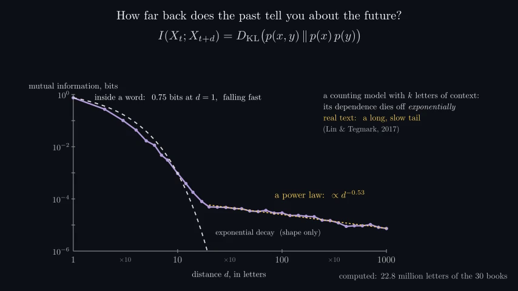
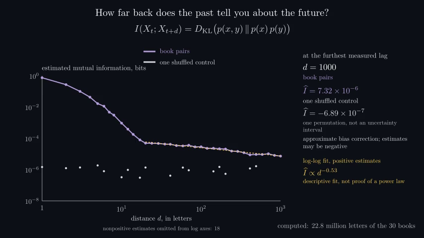
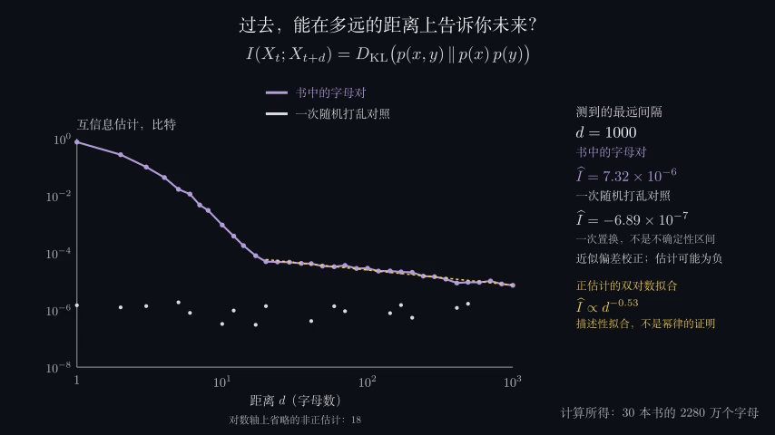

# AI, Built cloud QA progress

**Production approval remains pending for all31 parts.** Current checkpoint:1November2026. Parts1–5 have scoped bilingual source/data/endpoint and selected silent-motion review, with exact late-repair regressions and production/audio gaps retained in their ledgers. Actual narrated Part1opening production exposed a roadmap timing defect; its scoped source repair is cleared for rerender, not accepted final output. Part6 has22 completed numerical items,263 independent arithmetic/inference checks,8accepted bilingualselectedpreviewcases acrossitsfirstfourchapters, and4native1080endpointcases. Lasso/Logisticreveal/annotationrepairsareunderfreshaftervalidation; laterPart6capturesadvanceinmanifestorder. Parts7–31remainqueued.

[Current status](STATUS.md), [Part2](ai2-chapter-checklist.md), [Part3](ai3-chapter-checklist.md), [Part4](ai4-chapter-checklist.md), [Part5](ai5-chapter-checklist.md), [Part6](ai6-chapter-checklist.md), and the [production/listening queue](remaining-production-qa.md) supersede older dated checkpoints below. No selected-image pass is promoted to continuous perception, listening or production approval.

Baseline: `af170318c179bfb56fa28aafe73477c56f5b80d8`. Branch: `qa/ai-series-cloud-20261031`.
The checkout is `/workspace/explainer-videos`; the unrelated mounted repository was left untouched.
No repository `AGENTS.md` or `.agents/skills/SKILL.md` exists. Read `CLAUDE.md`, `videos/ai/LECTURE_GUIDE.md`,
`SYLLABUS.md`, and the Part 26 reference conventions.

## Scope and persistent checklist

The [inventory](ai-built-20261031-inventory.md) and [machine-readable inventory](ai-built-20261031-inventory.json)
list all 31 parts, all 553 chapters, both languages (1,106 cases), source hashes, and remaining checks per item.
Their cache counts are an explicitly dated, non-atomic existence snapshot, not QA evidence.

The source-based narration estimate is 27.23 hours English, roughly 54.45 hours for one bilingual playback pass.
This excludes model computation, rendering, repeated repair passes and listening. The documented CPU narration
fallback is expensive: the completed six-block Information narration used bounded CPU synthesis and is retained;
the server is now stopped. Other narration remains pending. Part 26's 63.5-minute
source estimate exceeds the stated 60-minute target and requires measured pacing review.

## Verified changes

- QA tools report warning-bearing renders as `needs-review`, preserve crash/motion mode, and detect source/input
  changes. Audio QA persists missing/stale capture cases, rejects stale narration, and aggregates signal failures.
  Reports separate endpoint, sampled visual, motion-render and audio coverage; full playback/listening stays pending.
- Part 1's guessing-text wrapper preserves trailing/repeated whitespace instead of crashing or misaligning counts.
- Failed/empty book downloads cannot be published as completed cached source texts. HTTP errors do not get cached
  as HTML books. Language-model partial results are keyed by the actual passage and model/paragraph configuration.
- Shared Chinese captions preserve uniquely identifiable reordered numbers when measurements change. The actual
  rebuilt corpus count exposed this problem. Regression covers 161 AI and 17 Analysis reordered numeric templates,
  plus ambiguous repeated-value and existing same-order behavior.
- KL mode covering/seeking uses a shared density scale without clipped peaks, shaded target distributions,
  synchronized mean/spread/KL readouts and mean±standard-deviation markers. Semantic colors remain consistent.
- Mutual information no longer aborts because a hoped-for tail-to-noise ratio fails on revised books. Lag-specific
  marginals, active-alphabet bias corrections, signed estimates and matched shuffled controls are retained.
  The picture labels a descriptive fit, discloses nonpositive omissions and finite-sample limitations, and avoids
  extrapolation or an unqualified universal Markov-model claim.
- Existing MI caches are schema-checked under their cache lock. Normal reads and the compute CLI rebuild legacy
  data; cached-only QA reports `stale-data` without computing or changing it. Five legacy-cache regressions pass,
  including a CLI that previously skipped the old completion marker. An isolated actual-worker integration check
  also confirmed the persisted `stale-data` result and byte-identical legacy cache. All 72 current unit tests pass.
- A subsequent Knowledge check exposed a QA false positive: approved Latin data inside a correctly translated
  Chinese caption was flagged when a measurement changed. The checker now verifies the complete translated
  numeric template against approved wording. An added regression rejects extra untranslated words; 73 tests pass.

## Before/after visual evidence

These are actual decoded frames from **only `CrossEntropy.asymmetry()`**, not full chapter or part approval.
Source/input hashes, frame times, decode and dead-air scan results are in [provenance](evidence/ai1-kl/provenance.json).
All four real silent 480p15 clips fully decode. English duration: 68.53 seconds each; Chinese: 72.33 seconds each.
Blank/sparse runs of at least 1.5 seconds: zero in each clip. Both after contact sheets (24 sampled frames each)
and endpoint comparisons were inspected; full visual playback and narrated listening remain pending.

| | Before | After |
|---|---|---|
| English |  |  |
| Chinese |  |  |

The local interactive review is `renders/qa/ai1-kl-comparison/index.html`; it links the four silent MP4s,
contact sheets and source/input provenance. Generated movies/caches remain ignored, consistent with repository policy.
The MI memory section also has real silent previews: reconstructed baseline English 58.73 seconds,
updated English 77.27 seconds, and updated Chinese 88.20 seconds. All three fully decode and have zero detected
blank/sparse runs ≥1.5 seconds. The baseline scene was reconstructed using the same regenerated measured cache;
the original baseline computation had failed, so this is not a legacy approved render. Two updated contact sheets
(24 sampled frames each) and endpoint frames were inspected. Source/data hashes include JSON, NPZ and corpus.
Full visual playback and narration remain pending; tiny values in scientific notation also need pronunciation review.

| MI memory section | Frame |
|---|---|
| Reconstructed English baseline |  |
| Updated English |  |
| Updated Chinese |  |

[MI provenance](evidence/ai1-mi/provenance.json); local video review: `renders/qa/ai1-mi-comparison/index.html`.
Final chapter cases are still being rendered; see the live local index below.

## Part 1 chapter coverage at this checkpoint

These are **endpoint runtime/layout checks**; a `passed` label does not claim full animation/playback QA.
Earlier-source/data records remain visible and must be rerun. The initial cache-only pass stopped when numerical
computation began; its incomplete records are not a sign-off. Final passes cover only completed immutable inputs.

| Chapter | English endpoint | Chinese endpoint |
|---|---|---|
| Hook | missing-data (earlier source/data) | not attempted |
| Probability | passed | not attempted |
| Surprise | passed | not attempted |
| Entropy | passed | not attempted |
| Prefix | passed | not attempted |
| Huffman | passed | not attempted |
| Typical | passed | not attempted |
| CrossEntropy | passed | not attempted |
| Arithmetic | passed | not attempted |
| Counting | passed | not attempted |
| Shannon1951 | passed | not attempted |
| Likelihood | passed | not attempted |
| Information | missing-data (earlier source/data) | not attempted |
| Knowledge | missing-data (earlier source/data) | not attempted |
| Units | missing-data (earlier source/data) | not attempted |
| Scoreboard | not attempted | not attempted |
| Outro | not attempted | not attempted |

- [x] Obtain separate checkout and isolated branch; inventory all parts; inspect production instructions.
- [x] Build an isolated Python 3.12/Manim 0.22 runtime; rebuild the documented book corpus and counting experiments.
- [x] Exercise numerical, cache, translation, QA-status and geometry regressions; compile all AI/shared/tool sources.
- [x] Inspect early chapter endpoint contact sheets and scoped KL before/after visual evidence.
- [ ] Finish all 17 Part 1 endpoint checks in both languages; resolve each warning and inspect updated sheets.
- [ ] Finish full silent motion renders, inspect intermediate animation and continuous playback, scan dead air.
- [ ] Finish pretrained-model results required by Hook, Knowledge, Units, Scoreboard and Outro.
- [ ] Start the documented local narration server; synthesize, listen and verify narration/visual synchronization.
- [ ] Build current narrated production cuts; measure duration, decode, verify markers/subtitles and final-resolution layout.
- [ ] Complete Parts 2–31 sequentially, then regress shared changes across rendered outputs of every part.

## Local evidence, active computation and next item

- Final chapter evidence/index: `renders/qa/series/index.html`; each case retains `result.json`, log, frames,
  contact sheet, source fingerprint and input signatures. Review records are bound to the inspected sheet hash.
- Model computation log: `renders/qa/ai1-model-compute.log`; the benchmark stores completed model rows in
  `.cache/ai1/lms.partial.json`. It is running on CPU with two threads. No synthetic substitutes are used.
- Completed pretrained rows so far: GPT-2 small 1.166, GPT-2 XL 1.012, Qwen3-0.6B 1.024 bits/character on the real passage; full scoreboard is pending.
- Counting logs: `renders/qa/ai1-compute.log`, `ai1-counting-compute.log`, `ai1-raw-compute.log`.
  A hoped-result MI assertion failed during the second batch; it was diagnosed and replaced with measured checks.
- Runtime activation: `source /workspace/runtime/activate.sh`. Manim/dvisvgm/Chinese TeX dependencies were installed
  under `/workspace/runtime`, without changing system files or the unrelated checkout.
- Next sequential work: finish Part 1 final English/Chinese endpoint passes, then motion passes for completed-data
  chapters. Defer the five model-dependent chapters until their data is atomically complete. Then narration and
  production review; proceed to Part 2 only after Part 1's outstanding coverage is explicit.

No web player application was found in this video-source repository. Responsive/player behavior in an external
hosting application is untested. Local decoded videos verify file integrity, not every browser/player.
No merge, deployment, paid service, new credential, or desktop execution was used.

Checkpoint generated: 2026-10-31T12:07:01.764323+00:00.

## Part 2 test-only preparation

While Part 1 rendering/audio runs, independent tiny fixtures reproduced the supplied TSP budget/replay, A*
boundary-tie wording, resolution factoring/empty-clause, and SAT censoring findings. The [report](ai2-preparation/REPORT.md)
retains exact APIs, source hashes, observed outcomes and scope limits. JIT was disabled and a process audit enforced
zero repository writes. These are focused bug reproductions; Part 2 implementation repairs, production JIT runs,
full computations, visual renders and audio remain pending. No Part 2 source was changed.

## Narration pronunciation repair

A real local Qwen3-TTS/ASR stress probe of scientific e-notation produced an ASR lead in which the negative
exponent was lost (best score 0.902, below 0.93). The [probe record](evidence/ai1-mi/pronunciation-probe.json)
retains exact expected/heard text, timing and waveform hash. This is ASR evidence, not manual listening.
The MI narration now says explicit signed millionths of a bit in English/Chinese; on-screen values are unchanged.
A regression evaluates the actual source utterance and verifies the Chinese negative sign; 74 tests pass and
all 160 narration source templates remain covered. Updated scene/audio checks are running. The earlier Information
audio job was cancelled as stale after one of six blocks; it is not a chapter audio pass. The server may finish
its already received request before accepting current-source work.

Observed CPU cost: the stress probe retained 10.28 seconds of speech after 633.1 seconds including four takes and
checking; the 3.6-second chapter-card utterance took 119.4 seconds. Those measurements expose a real narration
throughput limit in this 4-core CPU environment; full bilingual narration/listening is still outstanding.

## CPU narration memory failure

The first long Information paragraph caused the local narration process to exit 137. The 16 GiB container recorded
one OOM kill. The old Torch engine batched every pending sentence of a paragraph while retaining the speech, ASR
and alignment models in memory. CPU synthesis now serializes those chunks; the GPU path retains its original
batching. Two regression tests exercise the actual TorchEngine class with a model double, including order, voice,
language, retry temperature and maximum CPU batch size. All 76 tests pass. This is not real GPU validation.

The local server has been restarted with the bounded CPU path and two threads. A real repeat of current-source
synthesis is still pending; the memory fix is not a claim that the full narrated chapter or series passed. Earlier
throughput measurements used one speech thread alongside renders, so they are not a dedicated-machine benchmark.

## Frozen Part 1 factual correction batch (13:26 UTC)

This checkpoint supersedes the incomplete-data snapshot above: all Part 1 model measurements and numerical items
are now complete, including the real independent arithmetic-coding round trip. Every one of the 17 chapters has
been source-reviewed; [head review](evidence/ai1-source-review/head-review.md) and
[tail review](evidence/ai1-source-review/tail-review.md) preserve exact coverage and source-verification limits.
The identified corrections are implemented in English and Chinese; 161/161 narration sources and all 17 changed
on-screen captions are covered. Review notes describe pre-fix source; the translation handoffs record the applied batch.

| Chapters | Actual source findings and changes | Rendered follow-up |
|---|---|---|
| Hook, Probability, Surprise | Cached probabilities/chain rule/utterances cross-checked; no new numerical failure | Final bilingual refresh and visual review running |
| Entropy | Distinguish absolute entropy gap from Shannon relative redundancy | Updated bilingual capture pending |
| Prefix, Huffman | Bounds and cached optimality checked; correct both Huffman exercise merge histories | Final captures pending |
| Typical | Disclose finite-length AEP exercise as leading-exponential approximation | Final captures pending |
| CrossEntropy | Scope next-token loss to autoregressive pretraining; retain enhanced normalized KL diagrams | Final captures pending |
| Arithmetic | State Kraft normalization and prefix-consistency conditions | Inspect added note and timing |
| Counting | Disclose context order selected on scored passage; avoid all-context frequency overclaim | Inspect changed caption |
| Shannon1951 | Identify smoothed counting comparator separately from rank guesser | Inspect comparison label |
| Likelihood | Identify shared-logit toy gradient and backpropagation qualification | Inspect logit label |
| Information | Previous two letters jointly; signed millionths spoken clearly | Audio 4/6 blocks completed, zero detected signal/timing issues |
| Knowledge | Keep measured associations distinct from causal interpretation | Inspect captions and pacing |
| Units | Correct study inventory to 31 models and matched benchmark coverage | Inspect study caption |
| Scoreboard | Byte padding overhead, real subset versus estimated full-passage code, measured selection, current Hutter date/units | Inspect new multi-line captions |
| Outro | Plot complete reverse-KL peak; qualify code optimum, derivative and known-length prefix | Inspect recap and final pacing |

All 34 bilingual cases have earlier endpoint captures and full silent motion renders. The factual batch and a
necessary cached-only schema guard invalidate prior fingerprints; final passes are regenerating current evidence.
The guard rejects stale Part 2 caches before an upgrade loader can compute, preserving cached-only behavior.
76 full-suite tests passed after the factual source batch; 21 focused QA/cache tests then passed after the generic
guard regression. No full continuous playback/listening or production-resolution approval is claimed.

Bounded CPU narration has completed the previously OOM-triggering 35.6-second paragraph and two later blocks,
without another OOM. The unchanged ASR threshold is 0.93; the signed-unit stress probe scored 0.958 on its first take.
Full chapter audio/sync remains incomplete. CPU throughput varies substantially with retries and chunk length, so
no reliable completion ETA is available.

Part 2 repairs are being prepared in an isolated file scope while Part 1 renders/narration continue. No Part 2
production computations or rendered sign-off are claimed. Remaining Parts 3–31 remain untested.

## Rendered layout repairs

Native rendered frames exposed two defects beyond automated frame-bound checks: the expanded probability
column lacked a width-magnification cue, and the Chinese McMillan proof explanation collided with the plot's
log-scale label/tick. The probability pull-out now explicitly labels the magnification in both languages. The final
McMillan equation and its explanation stack vertically on the left, clear of the chart. All four focused bilingual
endpoint rechecks passed without warnings; their native frames were visually inspected.
[Before/after images and capture fingerprints](evidence/ai1-layout/) retain the actual evidence. This is endpoint
layout coverage, not continuous animation/playback approval. Focused layout/QA tests also passed (21 tests).

## Stronger temporal coverage and Part 2 measured verification

All34 Part1 bilingual endpoint sheets were inspected:707 primary endpoint thumbnails,46 priority native views,
plus focused repairs/reconciliation. Detailed [head/tail visual records](evidence/ai1-endpoint-review/) preserve
actual hashes and earlier/current distinctions. New captures are only marked reviewed when their sheet hash
matches exactly with an inspected asset; fresh content requires a new review.

`tools/qa_motion.py` decodes every source frame and detects RGB changes at reduced resolution, extracting
transition boundaries/midpoints, at most one-second spacing within detected motion, and static midpoints into
readable chronological pages. Six real-FFmpeg regressions pass, including a late one-frame flash and an
equal-luminance color change that grayscale misses. The current Chinese Hook audit decoded3569frames, found64
motion intervals, and extracted368native frames onto46sheets. [Exact times/settings/provenance](evidence/ai1-temporal/zh-hook-audit.json)
are retained; page-by-page visual review is ongoing. This does not certify undetected subthreshold changes or
continuous perceptual playback. Subsequent unrelated Part2 caption additions make the conservative whole-part
source fingerprint stale; the audit retains the original movie hash and capture provenance.

Part2's reproduced repairs and real default TSP/resolution outcomes are [documented](ai2-repairs.md). All116
repository tests pass. The default resolution result revealed an additional false success narrative; the scene
now reports a capped saturation run honestly, without raising the cap. Part2 full computation/source review is
underway; no Part2 rendered or audio sign-off is claimed. Part1 Information audio has reached5/6 blocks; ASR
pronunciation leads remain unresolved despite clean waveform/alignment checks.

## Completed narration chapter and motion repair

All six Information speech blocks completed with zero waveform/alignment issues and no further OOM. Six original
ASR leads remain retained. Independent pinned Whisper recognition decoded all six clips and the exact stress
probe, matching the key numbers, millionths and minus sign; [raw evidence](evidence/ai1-narrated/) distinguishes
automated recognition from manual listening. The complete English Information chapter then rendered with real
cached speech at1920×1080/nominal30fps,169.57seconds. Full audio/video decode passes, aligned words stay within
the movie, narration blocks do not overlap, and all15bookmark waits meet their targets with zero measured lateness.
The15bookmark-indexed frames were inspected. This is one chapter's automated AV evidence; continuous viewing,
manual listening and full-series narrated production validation remain unverified.

Dense Hook review found multi-digit ranks colliding during the1.5-second enlarged pulse. Highlighting now changes
color without growth, and rank-one opacity increases from.35to.55. Complete focused EN/ZH Shannon-method clips
were rendered and decoded; all345selected frames and52pulse-window frames were reviewed,371distinct postrepair
source frames in total. [Before/after images, hashes and review](evidence/ai1-rank-pulse/) verify separated ranks
throughout both windows. Complete repaired Hook motion renders also pass; their full dense review is ongoing.

Temporal extraction now fills every selected-time gap to at most one second, even when slow fades evade adjacent
frame thresholds. Nine real-frame/provenance tests cover late flashes, equal-luminance color changes, slow fades,
parser depth, failed refreshes and nonstandard sibling records. Old audits retain their original tool hashes.
All34 Part1 language/chapter cases are now undergoing complete selected-frame-content review, with exact-SHA
reuse distinguished from direct views. New lasting findings (Entropy rare-label spacing, Counting annotation/curve
intersection and rounded numeric equality) are queued for one coherent repair batch after that pass.

## Part1 complete selected-timeline pass and repaired regressions

All34 bilingual baseline timelines completed dense selected-content review:109,941 frames decoded automatically,
15,194 selected times covered directly or by exact-PNG proof. [Per-case summary](evidence/ai1-temporal/full-selected-coverage-summary.json)
and [complete review ledgers](evidence/ai1-dense-review/) preserve direct views, byte-identical inheritance,
page/native hashes and unviewed intervals. This is not a claim that every decoded frame was visually perceived.

Four remaining confirmed issues are repaired and regressed in all eight affected language/scenes:
Entropy q/z labels have separated leader callouts; Counting's clarified best-point label sits clear of curves
with an arrow; numeric rounded CE examples use≈while the symbolic identity stays exact; Arithmetic's final bit
pulse retains its size. Rare-symbol emphasis now targets only the chosen interval/readout, preserving partition
contrast. All8 full silent regression renders pass with zero warnings. New selected-content inspection covers
all changed pixels by explicit time/hash mappings;125 consecutive source frames also cover critical pulses.
No new confirmed defect was found. All126 tests pass after these changes.

Part1 numerical/source/EN+ZH rendered selected-frame coverage is complete at this scope. Full continuous
perceptual playback and listening remain unverified. Only Information EN has a complete narrated1080p chapter,
independentASR and15bookmark checks. Parent's independent cloud desktop played that original clip to its end
with timed screenshot samples; it found a visible narrow-right-margin polish item. That separate inset repair
and a timestamp compatibility check are in progress, without treating the editor VFR warning as playback failure.
Remaining16chapters' full narration/audio QA, allChinese audio and full production cuts remain pending.

Part2 is next for rendered QA: its source/correctness work and all19 default computations completed. Two later
search fixes address a concrete scaled-priority grid defect and conditional capped-optimum handling; affected
grid/puzzle15 data are being refreshed under schema locks before any Part2 render. NoCI/CD, runners, merge or
deployment were configured. Verified increments continue on the dedicated branch.

## 18:47 UTC sequential checkpoint

Part2's complete 32-case frozen selected pass accounts for14,068times/105,217decodedframes. Knowledge's subsequent boundary-anchor/caption-clearance repair has892selected-time regression checks and41native1080p endpoints; replacement current total14,062selectedtimes. All production/narration/perception gaps remain in the explicit open queue.

Part3 methodology/cache source repairs are pushed, and the missing actual bilingual retrieval-branch test is published with its ten-test rerun receipt. First nine data-ready scenes have342EN/ZH endpoint images reviewed. Motion review is finding transition-only defects beyond those endpoints, and targeted repaired regressions are underway. English Einsum has390selected-time review and a separate exact-hash native cloud playback receipt. Eight numerical items are complete; novels training reached1,971/2,929steps with durable checkpoints. No unfinished input is rendered.

Shared Chinese caption regression found zero output changes over2,265unique captured strings across Parts1/2. This does not erase stale broad source fingerprints. A prepared two-file Library refresh failed at tools/listHTTP401 before preparation; existing versions remain unchanged, no operation is pending and no unchanged retry is attempted. Source/evidence publication continues through ordinary authorized branch pushes.

## 21:03 cache-integrity upgrade and current rendered queue

The eight formerly existence-only Part3 items now have explicit structural/arithmetic, payload-hash, recipe and
current-dependency validation. Legacy sidecars were staged under locks before activating the guard; all26numerical
payload bytes, sizes and modification times are unchanged. All17actual cache loads succeeded with every producer
replaced by a fail-on-call mock (zero calls). The new records are explicitly post-production attestations: original
consumed dependency hashes were never recorded and are not reconstructed. Historical QA ledgers omit these new
sidecars. The original nine-versus-eight scope correction remains intact.

Forty focused cache/numerical tests and the235-test full repository suite pass. The suite precedes the subsequent
GaLore rank-qualification prose, which has a separate10-test narration pass. No test result constitutes rendered
approval. [Cache upgrade evidence](evidence/ai3-cache-integrity-upgrade/README.md).

All38Part3 bilingual endpoint and silent-motion runtime cases exist at observed versions. Fresh visual regressions
continue for Words/Geometry/JL, Norms/GaLore, SGNS and Netflix; Outro's two Chinese captions are repaired and both
fresh endpoint/motion cases have zero warnings. Actual final selected-image review is still pending for those cases.
Part3's completed numerical workloads are not running or being regenerated. Storage remains about4.3GiB free;
only the documented inactive public ASR download cache was reclaimed, preserving unique evidence and pending uploads.

## 21:20 current Part 3 selected-review milestone

Seventeen of the 19 chapters now have completed bilingual selected-frame review after their current repairs.
Netflix's final Chinese review and the final Outro caption-wrap regression remain active. New complete proof
packages cover Norms/GaLore, SGNS, Words/Geometry, HighDim/JL and Projection; the chapter checklist maps each
actual scope. No runtime status or historical warning was relabelled to imply visual approval.

Part 3 native production-resolution endpoint checks now cover additional completed cases. Spectra's31 captures
were inspected on eight960px-tile pages and eight native-pixel critical crops; no new layout defect was observed.
The separate LowRank/Norms/GaLore six-case pass inspected127 captures on35pages plus16native originals, with
source-change warnings retained. Other assigned chapter captures/reviews continue. These are endpoint checks,
not full1080p motion or listening sign-off.

Independent review's two cache robustness findings are repaired and pushed at90f700b. All238 repository tests
pass, and actual loads of all17items still succeed with fail-on-call producers. All26numerical payloads retain
their original hashes, sizes and modification times. No valid expensive experiment was regenerated.

A normal, non-forced uv cache clean reclaimed reproducible task-local package/download entries; the tool reported
132.1MiB removed and observed free space increased156,946,432bytes while other render writes continued. All
installed module entry-file hashes checked remained unchanged. Sources, numerical/model results, original visual
evidence and pending-upload files were outside the cleanup. The exact action/inventory receipt is preserved.
