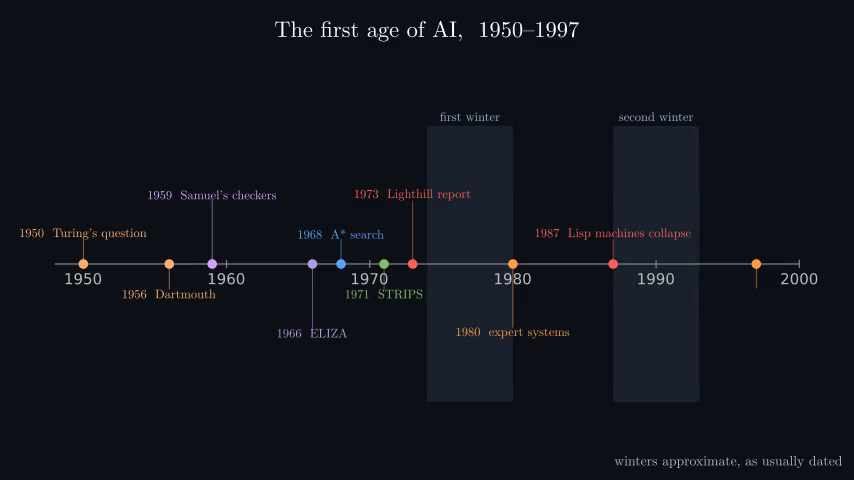
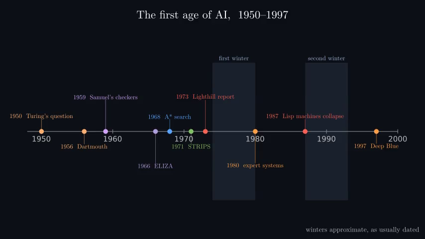
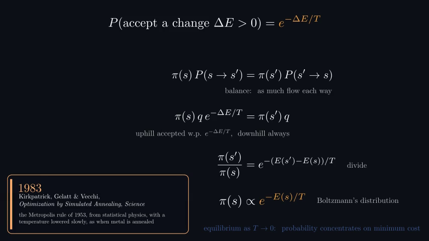
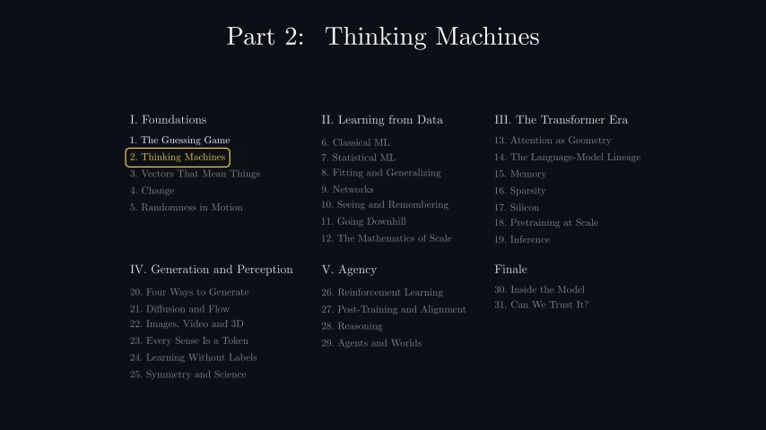
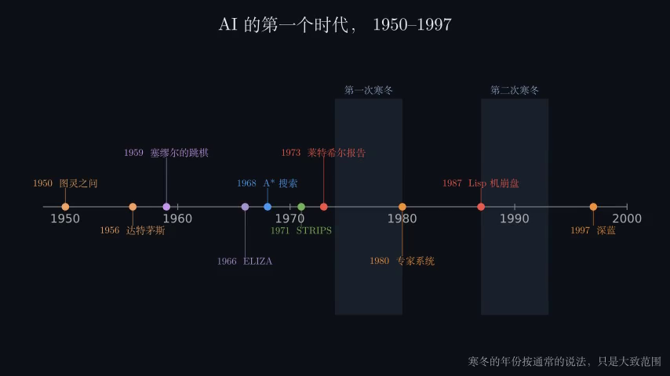
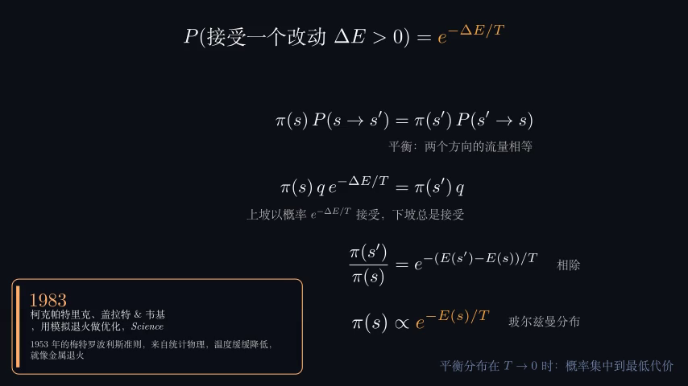
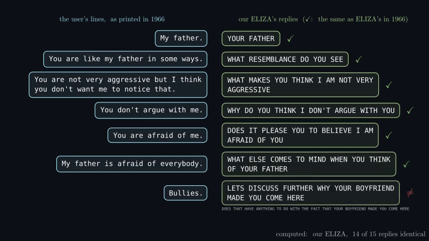
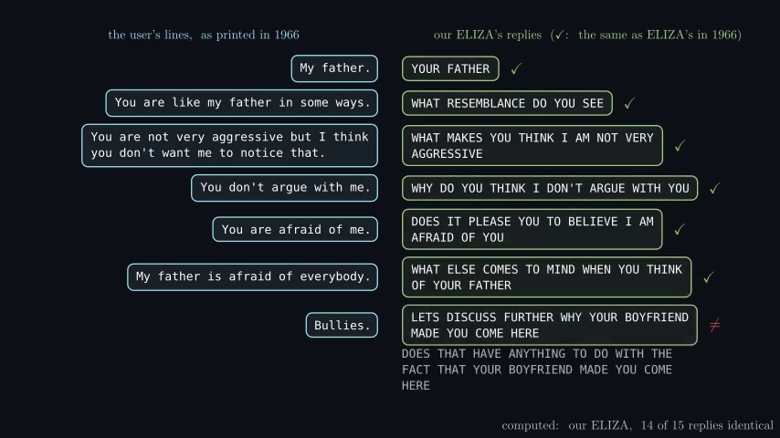
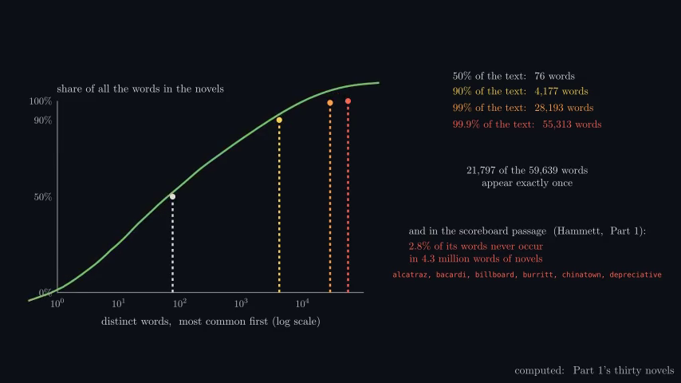
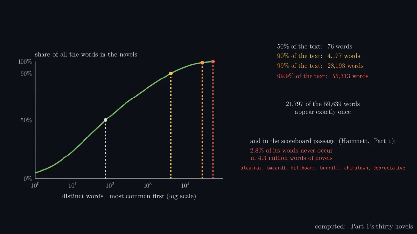

# Part 2 proof and planning visual repairs

The proof diagram had a long parent-to-conclusion line passing through an unrelated clause. It now routes around
intervening boxes with a clear conclusion arrowhead. Native EN/ZH propositional and first-order views were checked;
the English full silent movie also received 456 selected-frame inspections plus 11 native follow-ups, with no new defect.
Two geometry tests exercise obstruction avoidance and actual conclusion endpoints. This does not establish continuous
perceptual viewing or audio listening.

The planning chart's completion coverage was too small beneath the axis. A larger right-column panel now separates
solved/attempted counts, unresolved cases and unrun/unknown cases. Matched solved plan lengths remain separate from
observed expansion work. All 22 English and 24 Chinese final endpoint captures were inspected; native before/after
measurement shows the English main coverage row increased from 9 to 15 foreground pixels at 480p. No new collision
was seen. Current default BFS and h-max attempts all solved 48/48; each has 36 unrun cases; greedy solved 84/84.
The 12 matched seven-block problems remain 11.3 optimal versus 15.3 greedy mean steps. Data and plot semantics are unchanged.
There is no retained Chinese before image for this planning layout; only its verified after image is supplied.

| Scene | Before | After |
|---|---|---|
| Logic English |  |  |
| Logic Chinese |  |  |
| Plans English |  |  |

Hashes, original paths, exact reviewed times, geometry checks and source-scoped limits are preserved in adjacent JSON.
Shared-table edits conservatively stale aggregate fingerprints. The separate caption-dependency comparison verifies
actual collected translation outputs; it does not silently promote old records to current automated passes.
Narration listening, continuous perceptual playback and production-resolution review remain pending.

The opening timeline's 1997 Deep Blue label disappeared after a conflicting simultaneous reveal/highlight.
Those animations now run sequentially inside the original one-second window. Both final movies were checked:
272 English and 282 Chinese selected appearances, including all changed groups and eight native follow-ups.
The roadmap is locally 12.5% larger, with separated columns and clear title margins; semantic colors are preserved.

| Additional scene | Before | After |
|---|---|---|
| Opening timeline EN |  |  |
| Equilibrium caption EN |  |  |

The equilibrium caption's cool-blue source contrast rose from 2.80:1 to 5.57:1 by brightening that text alone.
Temperature curves, wording and timing are unchanged. The English repaired movie has 527/527 selected times
covered (499 exact-frame inheritances; 23 newly viewed unique frames). Chinese received its first complete review
across 553 selected times, with no new observed defect. A Chinese before movie is not claimed.

All 150 repository tests pass after the producer and visual repairs. Complete decoded playback is automatic;
selected-frame review and native endpoint inspection remain distinct from continuous perceptual playback/listening.

The ELIZA comparison now wraps the complete original reply into three lines at its intended font size.
Both full pages fit, verified in389English and449Chinese selected times; all original characters are preserved.
The English before image is from the original render. The original full before MP4 was overwritten before a
full-movie backup was made; its native frames, sheets, source and original hash are retained. It is not relabeled
as a preserved or reconstructed original movie.

Winters' measured cumulative curve now receives color-only emphasis. The old scaling briefly moved the curve
above100% and belowzero, away from the threshold markers.417English and452Chinese selected times were covered;
19consecutive Chinese emphasis frames also keep the geometry aligned. The original English before MP4 was
preserved and its SHA matches the original review ledger.

| Final repairs | Before | After |
|---|---|---|
| ELIZA reply |  |  |
| Cumulative curve |  |  |
