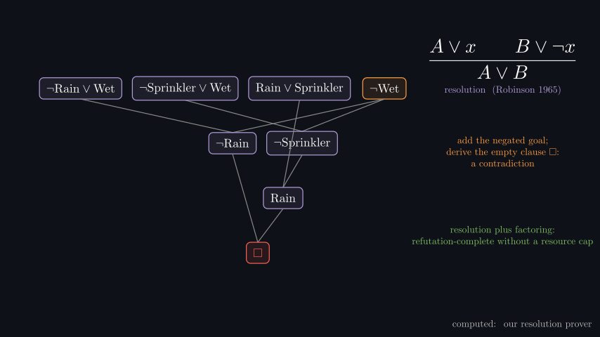
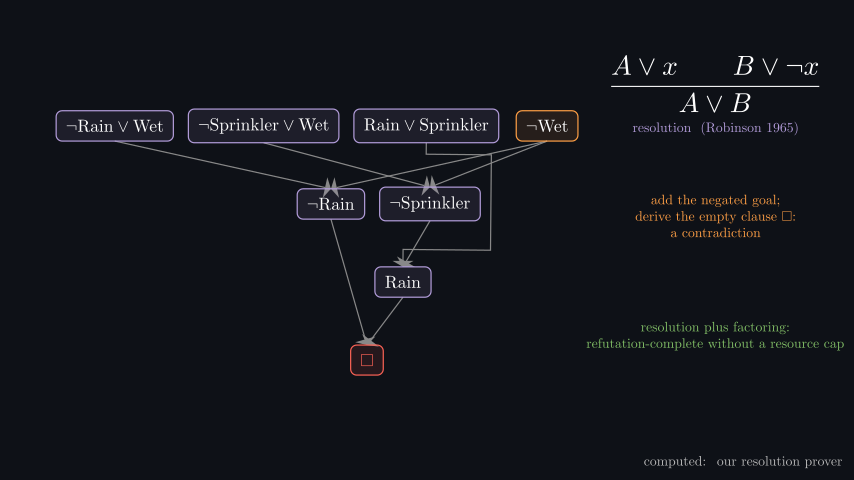
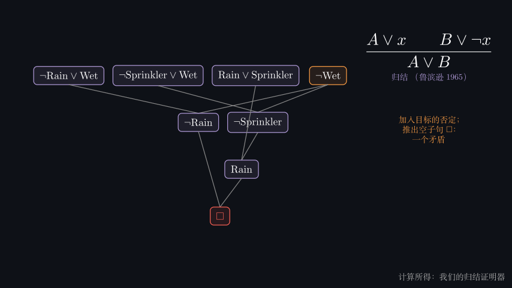
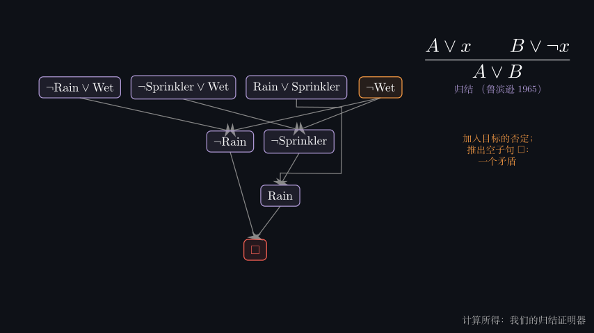
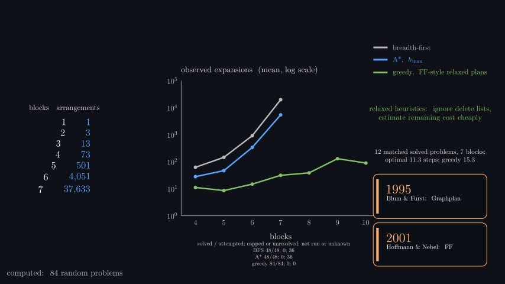
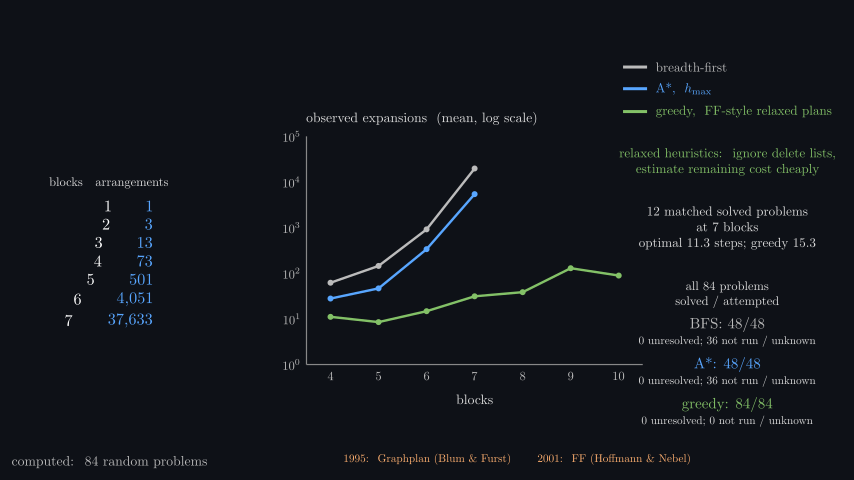
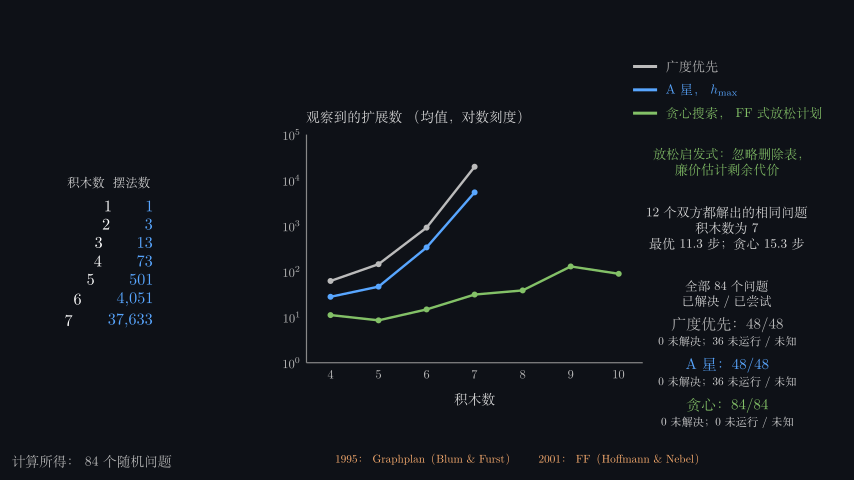

# Part 2 proof and planning visual repairs

The proof diagram had a long parent-to-conclusion line passing through an unrelated clause. It now routes around
intervening boxes with a clear conclusion arrowhead. Native EN/ZH propositional and first-order views were checked;
the English full silent movie also received 456 selected-frame inspections plus 11 native follow-ups, with no new defect.
Two geometry tests exercise obstruction avoidance and actual conclusion endpoints. This does not establish continuous
perceptual viewing or audio listening.

The planning chart's completion coverage was too small beneath the axis. A larger right-column panel now separates
solved/attempted counts, unresolved cases and unrun/unknown cases. Matched solved plan lengths remain separate from
observed expansion work. All 22 English and 24 Chinese final endpoint captures were inspected; native before/after
measurement shows the English main coverage row increased from 9 to 15 foreground pixels at 480p. No new collision
was seen. Current default BFS and h-max attempts all solved 48/48; each has 36 unrun cases; greedy solved 84/84.
The 12 matched seven-block problems remain 11.3 optimal versus 15.3 greedy mean steps. Data and plot semantics are unchanged.
There is no retained Chinese before image for this planning layout; only its verified after image is supplied.

| Scene | Before | After |
|---|---|---|
| Logic English |  |  |
| Logic Chinese |  |  |
| Plans English |  |  |

Hashes, original paths, exact reviewed times, geometry checks and source-scoped limits are preserved in adjacent JSON.
Shared-table edits conservatively stale aggregate fingerprints. The separate caption-dependency comparison verifies
actual collected translation outputs; it does not silently promote old records to current automated passes.
Narration listening, continuous perceptual playback and production-resolution review remain pending.
