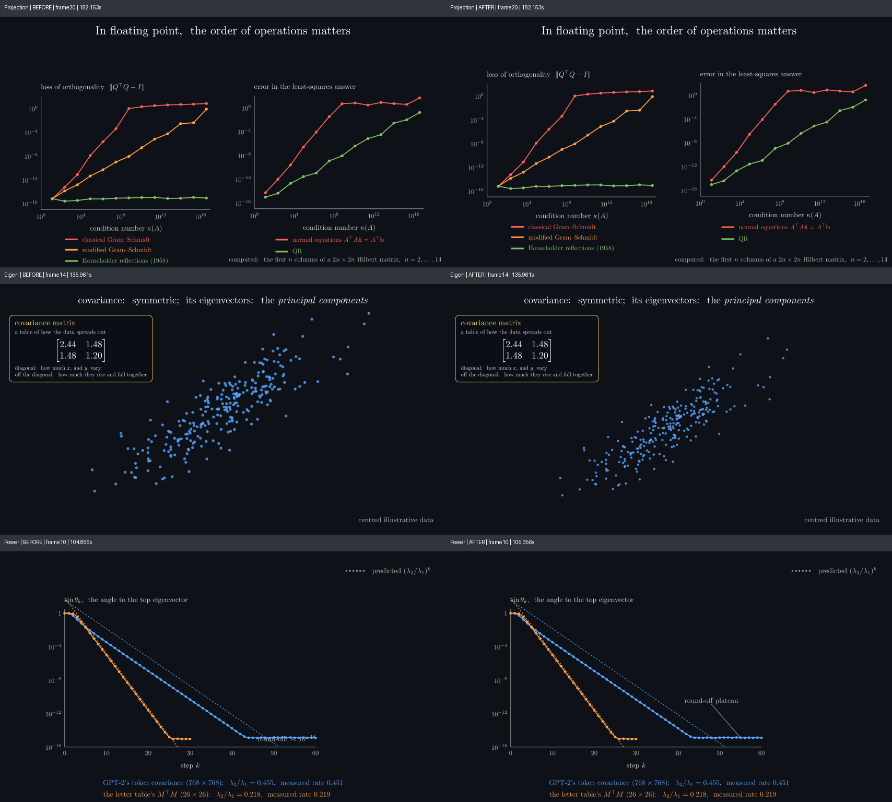

# Part 3 endpoint visual repairs

These are preserved **endpoint / narration-hold images**, not motion, continuous-playback, audio-sync or final-resolution approval. The original reviews confirmed the six repairs below in English and Chinese preview output (854×480). This package copies existing evidence; it performs no new render or production computation.

| Repair | Before | After |
|---|---|---|
| Hook: dark glyph halos keep cloud labels readable | [EN](images/en-hook-before.png) | [EN](images/en-hook-after.png), [ZH](images/zh-hook-after.png) |
| Vectors: disclose the shared raw-logit floor, retain raw values | [EN](images/en-vectors-before.png) | [EN](images/en-vectors-after.png), [ZH](images/zh-vectors-after.png) |
| Matrices: dark local backgrounds protect composition titles | [EN](images/en-matrices-before.png) | [EN](images/en-matrices-after.png) |
| Projection: lift both plots and legends together, clear the bottom band | [EN](images/en-projection-before.png), [ZH](images/zh-projection-before.png) | [EN](images/en-projection-after.png), [ZH](images/zh-projection-after.png) |
| Eigen: uniformly change the PCA viewport, preserving geometry | [EN](images/en-eigen-before.png) | [EN](images/en-eigen-after.png) |
| Power: move the plateau annotation above the curve with a leader | [EN](images/en-power-before.png) | [EN](images/en-power-after.png), [ZH](images/zh-power-after.png) |

The original EN reviews cover 110 endpoint timestamps across these six scenes: 18 changed images newly inspected and 92 byte-identical PNG matches inherited from prior actual views, with additional native follow-ups. The first-four ledger also retains 23 unchanged Einsum endpoints; those are outside this six-repair count. The Chinese refresh covers 116 timestamps: 12 changed native images actually viewed, 104 exact-PNG matches inherited, plus three repeated native checks. Reuse is by exact SHA256, not perceptual similarity. Selected examples here do not replace the full timestamp/hash/reuse ledgers.

For Projection, the Chinese review measured 24 blank raster rows beneath the repaired Householder legend, compared with zero before. The Eigen review checked that the ellipse, principal directions and projected points share the viewport. The Vectors helper fixtures reconstruct negative, equal and mixed scores from floor plus scaled height; these are synthetic helper checks, not additional model measurements.

**Historical provenance is preserved.** Hook EN and ZH endpoint evidence uses frozen direct-source SHA256 `2cc150ba66e921c64279c1d8a5965836c5971f947d55defb83a69a9a7aa7eae1`. It predates the later Hook transition source `ef357b016949f41b3a5383891534634d83dfc84518bd53b228f82e87baef5a3a`. These endpoints do not validate that later transition or establish current source freshness. Hook EN/ZH and Matrices ZH retain their recorded `needs-review` / `source-changed-during-render` warnings. Older broad fingerprints and snapshot-time checks remain historical; a later source hash cannot establish worker-loaded source.

[manifest.json](manifest.json) records original paths, exact hashes, frame indices/times (including differing before/after times), compression hashes and the Hook caveat. The [ledgers](ledgers/) preserve the original JSON bytes under gzip, including original absolute runtime paths. Baseline ledgers and per-frame provenance retain inheritance proofs, source/input signatures, review counts and limits. Runtime paths may be unavailable outside the original cloud workspace; the linked PNG examples are included here.

Verify packaged files with `sha256sum -c SHA256SUMS`. Read a ledger with `gzip -dc ledgers/en-first3-repair.json.gz`. Continuous motion, animated leader/title behavior, narrated listening/synchronization, player/responsive behavior and production-resolution QA remain outside these endpoint reviews. Cauchy aligned/antiparallel instants were absent from these endpoint captures.
