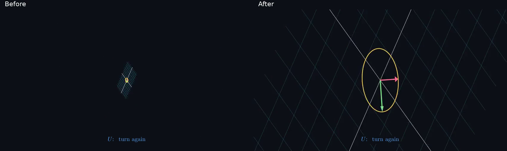

# SVD silent review artifacts

The complete repaired English480p15 preview is saved in Library as `libfile_4114eee4298c8191835a2fad409fa259`,version0. Exact movieSHA256:59090e74b89b7dc10c8e0d85cafb6cd17bd7917f5a0e645a55bba13cc0fc59d0; sceneSHA256:cd3b22f6f86ad33a548983025d490e53c322c5479803d0cb5292f8e3ab74dd10.

A separate10-second before/after comparison is saved as `libfile_3daf557515708191bd0146eb0451066e`,version0. It pairs original/repaired seconds7–17 at native854×480 per side, with an added32pixel title band, sampled to15fps and re-encoded. It is a derived review artifact, not either original movie. Exact source hashes and FFmpeg command are retained in the provenance JSON. The poster below was actually inspected and shows the old collapsing ellipse versus the rigid turn.

Both Library creates succeeded; their identities/versions/sizes are in the supplied receipt, and all returned version attributes were applied to the local files. The full English source movie already has completed selected-time regression; Chinese has its separate exact-artifact review. Native cloud-desktop playback of these new files has not yet been reported. No narrated listening, audio sync, continuous perceptual or final-resolution approval is implied.
