# Part3 Words/Geometry visual regression

Four fresh English/Chinese silent previews verify the analogy-label, measured-bar pulse and mean-caption transition repairs. The earlier histogram repair also keeps raw blue and centered yellow consistent with captions and legends. Source/data/positions/voiceover/bookmarks/duration are preserved; the actual-Manim fixture receipts record those checks.

| Final case | Decoded frames | Selected times | New actual views | Exact old matches | Exact new duplicates | Changed pages |
|---|---:|---:|---:|---:|---:|---:|
| en-Words | 2782 | 392 | 52 | 312 | 28 | 7 |
| zh-Words | 2984 | 412 | 56 | 329 | 27 | 7 |
| en-Geometry | 2425 | 306 | 6 | 300 | 0 | 1 |
| zh-Geometry | 2579 | 326 | 11 | 315 | 0 | 2 |

Total: 1436 selected times; 125 newly inspected native-size image contents on 17 chronological sheets, 1256 exact original PNG matches and 55 exact new duplicates. Eight standalone native follow-ups checked the original defect times. All 68 endpoint frames are accounted for: 6 new direct views and 62 exact previously reviewed PNGs.

The four original artifacts were separately reviewed at 1,435 selected times: 1,013 actual unique contents on 128 chronological sheets plus 422 exact duplicates. Their ledgers remain historical; fixed output does not retroactively change original findings.

## Native before/after evidence

Each pair preserves full PNG bytes. The JSON index gives exact SHA, time and source-frame/endpoint index; before/after times can differ for the earlier endpoint-only histogram color repair.

### en-Words: analogy-label

Copied arrow now passes behind intact france glyphs.

| Before | After |
|---|---|
|  | 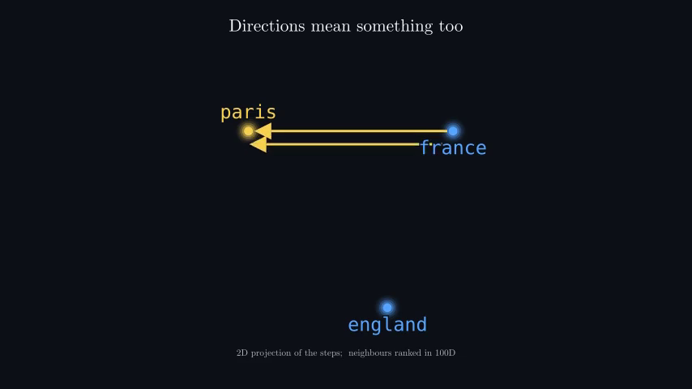 |

### zh-Words: analogy-label

Chinese-timed copied arrow preserves the same intact label.

| Before | After |
|---|---|
| 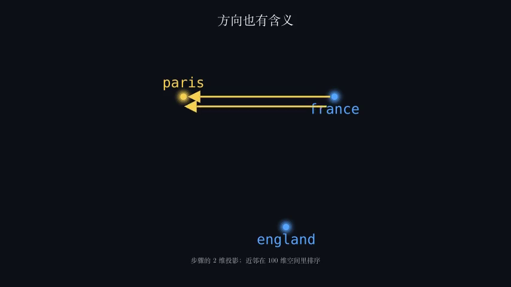 | 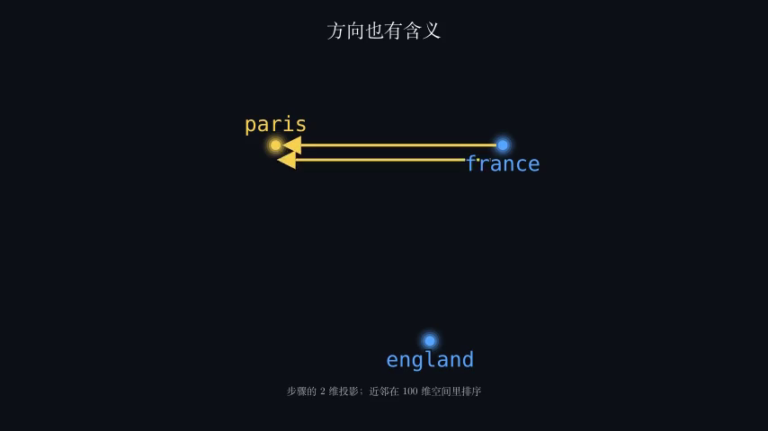 |

### en-Geometry: pc-pulse

White emphasis keeps measured bar height/baseline and tick1 visible.

| Before | After |
|---|---|
| 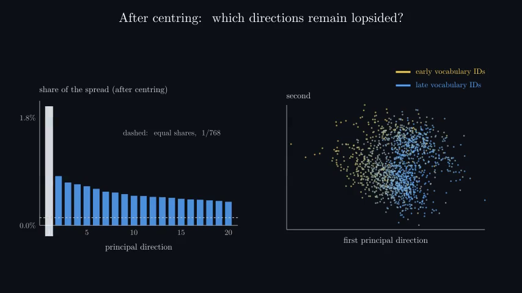 | 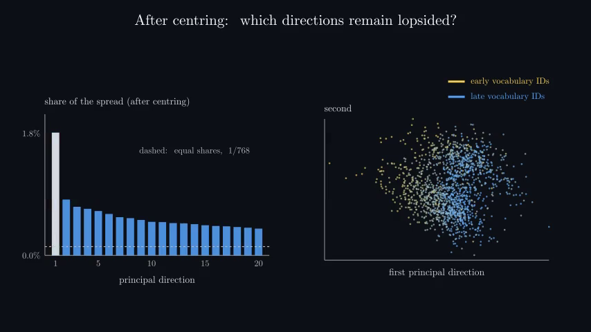 |

### zh-Geometry: pc-pulse

Chinese-timed white emphasis keeps tick1 clear.

| Before | After |
|---|---|
| 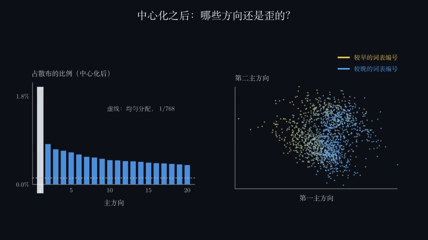 | 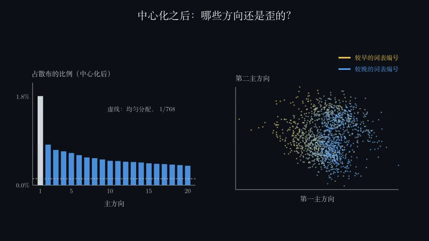 |

### en-Geometry: mean-transition

Sequential old/new mean captions leave a clean transition midpoint.

| Before | After |
|---|---|
| 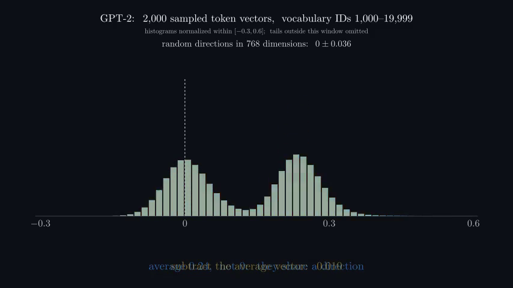 |  |

### zh-Geometry: mean-transition

Chinese old/new mean captions no longer superimpose.

| Before | After |
|---|---|
| 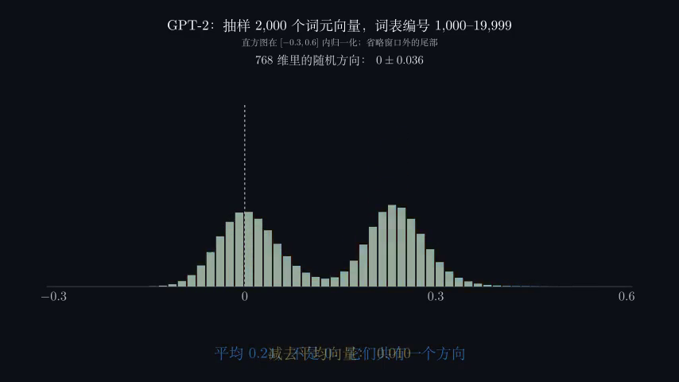 | 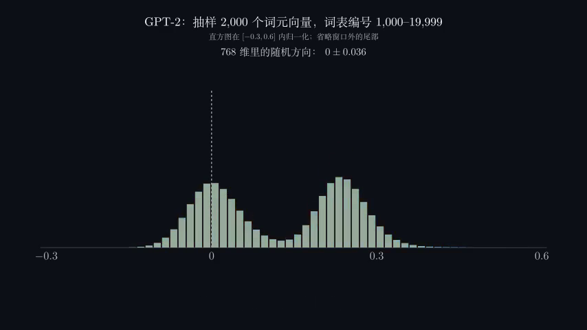 |

### en-Geometry: histogram-semantic-color

Earlier centered histogram was blue despite yellow caption; final centered bars and caption both yellow.

| Before | After |
|---|---|
| 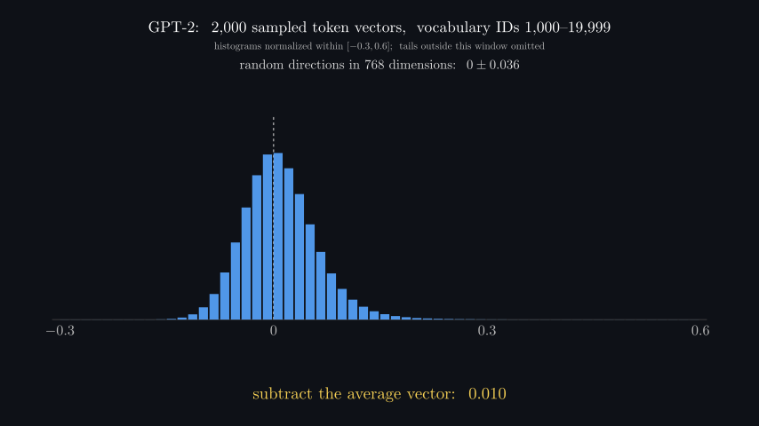 | 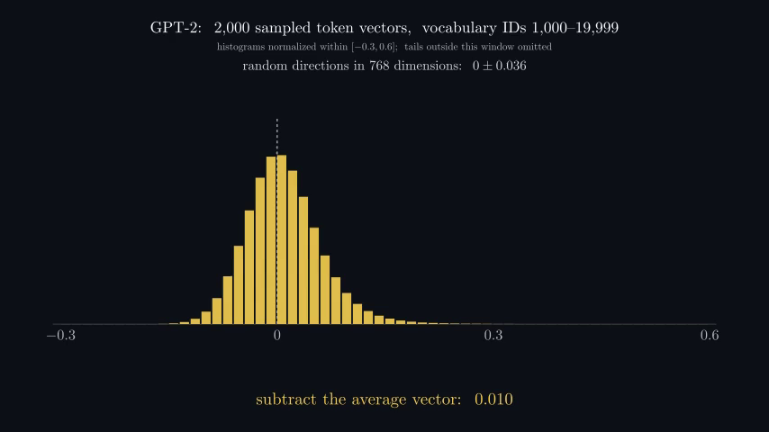 |

## Provenance

Words source: `97e14f916b8fbd72d5ff1ec35e6ff58a7e4f760e34db3352ae9db7f547036eaf`.
Geometry source: `7d9923cf29cc01dbe96299d569daa7b86abc99fdca9b495c007c18687b481f5a`.

| Movie | Exact SHA256 |
|---|---|
| en-Words | `b340a75ef4a455829436c11a8652919c89e13ea585f3847adf6f06a98a4a95ec` |
| zh-Words | `d73ea734d603d4331611317c129dffe2b999afa001042b40b590491eafe5a601` |
| en-Geometry | `361402267d88e047eb8acb438ff2406e9b61fde905b89bfdec27defc893537c4` |
| zh-Geometry | `f4c0d0e30ce07a5b8432bfee4e1d515ffb6eaa3268c9ebb8c9c1a5c476570947` |

The parent’s initial Words hash transcription had an extra trailing 2; this package uses the verified 64-character SHA values above, confirmed against movie bytes. The original render records are unchanged. Gzip payloads preserve complete original JSON/script/log bytes and are independently hashed in manifest.json. `notes/` gives readable chronological observations. `index.json` maps all records, case counts and native pairs.

## Remaining limits

- Automatic FFmpeg full-file decode/RGB detection is not perceptual playback.
- All selected contents were actually inspected or inherited only through exact full PNG SHA; unselected source frames are explicitly listed in each audit and were not individually visually inspected.
- Largest selected gap is 1s, with 15fps timestamp quantization/floating-point representation; subtle/subthreshold changes can evade detection.
- Silent 854x480, 15fps previews do not establish narration/audio sync, full-resolution export readability or responsive/player behavior.
- Final render records all passed with zero runtime warnings. Aggregate fingerprint was stale at extraction after later unrelated edits; scoped Words 97e14f and Geometry 7d9923 plus consumed data were independently hash-verified. No aggregate-current sign-off.
- Absolute runtime evidence paths are provenance references. This bounded repository package contains exact compressed ledgers and representative native before/after images, not all preview movies or extracted PNGs.

Minor retained typography: Chinese Harris quotation wraps a comma onto the start of its second line. Optional caption-queue polish; text remains readable. No global/local-Chinese text was changed in this repair batch.
