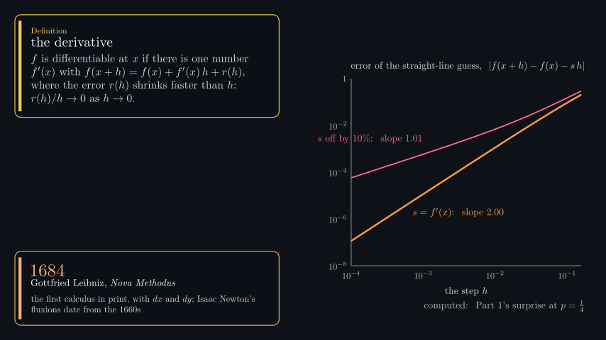
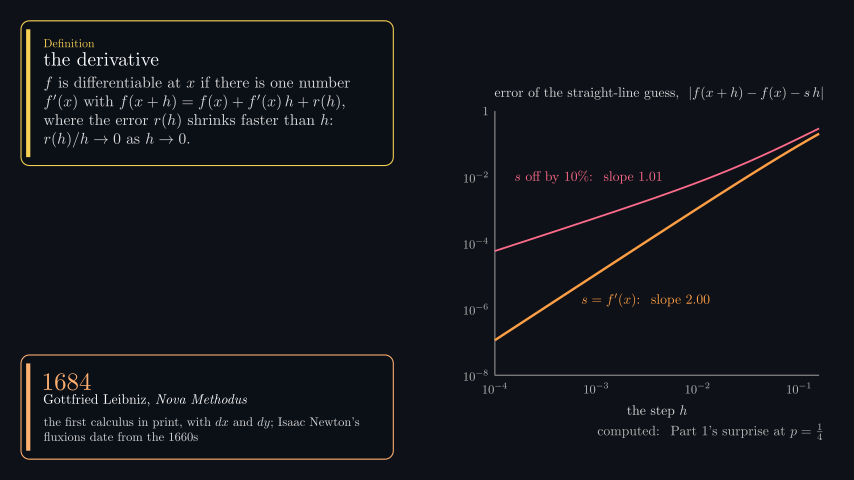
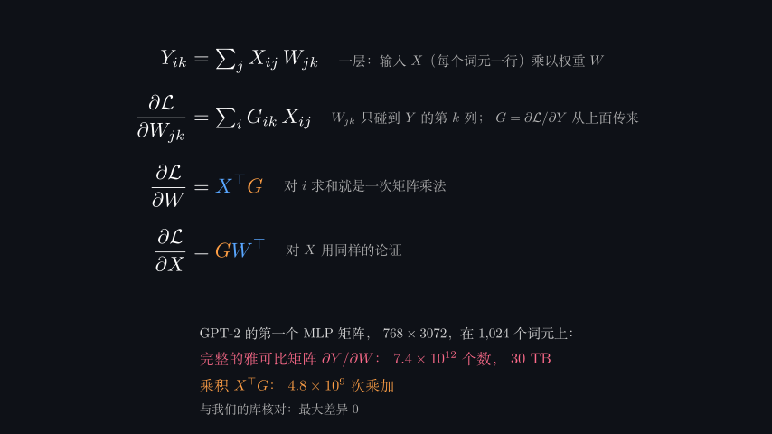
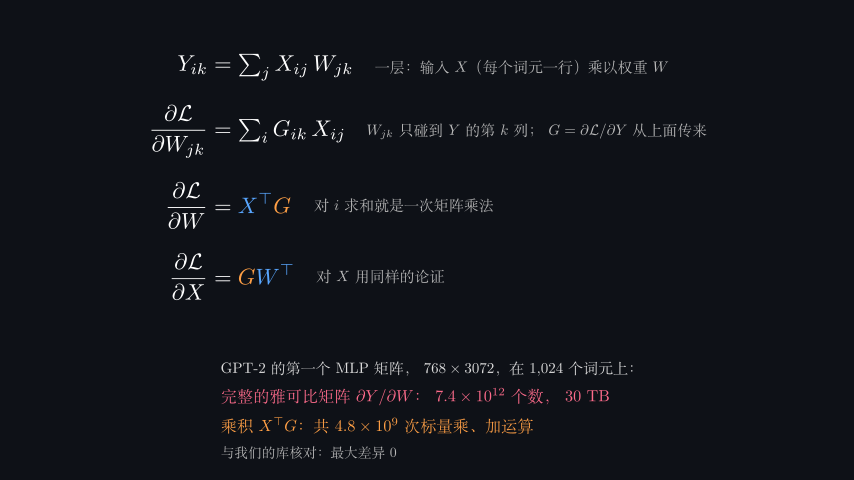

# Part4 first five bilingual endpoint review

The selected set contains **10 bilingual cases /158 endpoint appearances**: Hook19, Derivative17, Gradient19, Jacobian10 and Layers14 in each language. All79 fresh English PNGs match the previously completed actual visual reviews **byte for byte**, including the corrected Derivative state. All79 Chinese endpoints were actually inspected on five chronological sheets at427×240 per image, with21 specified native854×480 followups. The later Chinese Layers unit repair adds one changed native view and13exact prior matches. This is endpoint-image QA, **not full motion or continuous perceptual playback**.

|Chapter|EN appearances, exact prior inheritance|ZH sheet appearances viewed|ZH native followups|Observed result|
|---|---:|---:|---:|---|
|Hook|19|19|5|Chinese natural-log/bits qualifier, actual pinned-header provenance, per-square schematic scale, alternating timeline and outline remain legible within their margins.|
|Derivative|17|17|5|Definition/history cards, five-row derivation and finite-interval/6x-scale disclosure fit. The repaired bad-slope annotation clears the y-axis in both languages.|
|Gradient|19|19|5|Surface/cut/tangent labels, nonzero-gradient theorem, unit-direction plot and descent path remain clear. One readable, nonblocking line-leading Chinese comma remains in the Cauchy history-card continuation.|
|Jacobian|10|10|3|Map/Jacobian inset, definition/composition panels and gain curves/seed-band/norm-bound qualifications remain readable without new collisions.|
|Layers|14|14|3, plus one changed repair view|VJP/softmax/layer-normalization panels fit. A factor-two operations-unit translation problem was found and corrected as shown below.|

The earlier actual English review inspected79endpoint images on five sheets and20native followups. Its English Derivative repair accounted for16unchanged PNGs and one directly viewed changed native image. `prior-en-actual-review.json.gz` preserves that completed chain and all hashes. `english-exact-inheritance/` binds every fresh English endpoint to those exact reviewed PNGs; no perceptual similarity was used. English native images/sheets here are historical review baselines, so the original Derivative sheet/native008 still shows the old collision. The corrected frame is explicitly shown in `images/repairs/` and the inherited final records remain separate.

## Confirmed repairs

The original English Derivative bad-slope label crossed the plot y-axis. Root moved the local annotation into the clear plot region without changing its text/font/data. The directly inspected after-image has about21pixels of horizontal axis clearance and visible curve clearance. The integrated Chinese frame independently confirms the same geometry. Exact before/after hashes, color-pixel regions and the prior source identity are preserved in the prior English receipt.

|English Derivative before|English Derivative after|
|---|---|
|||

Chinese Layers native005originally showed **4.8×10^9次乘加**, where the English/source quantity counts individual multiplications and additions. Under the producer’s two-scalar-operations-per-pair convention the recorded values are4,831,838,208scalar operations versus2,415,919,104multiply-add pairs. The translation therefore introduced a factor-two unit ambiguity relative to the repository’s established “乘加”/multiply-add convention. Root changed that one caption to **共4.8×10^9次标量乘、加运算**, preserving the measured number. The fresh native005is legible and inside the frame; the other13PNGimages match the actual prior Chinese review exactly. `chinese-unit-repair.json.gz` preserves all14timestamp/image mappings, raw statuses, caption text/bounds and data observations.

|Chinese Layers before|Chinese Layers after|
|---|---|
|||

The initial integrated10records all report `passed` with zero warnings. **The corrected Chinese Layers record instead remains `needs-review` with `source-changed-during-render`.** Root identifies the overlapping edit as only the unrelated Floats definition-card layout in `s10_floats.py`, during corrective case95948. The corrected caption table was already in place at launch; direct Layers source and numerical inputs were unchanged. The actual changed native image proves which caption was used, and13exact-image matches preserve its other endpoint coverage. This scoped proof does not erase the broad warning or establish every historical worker import. No redraw was done merely to remove the warning.

## Evidence and limits

`records/final/` selects nine initial integrated records and the corrected Chinese Layers record. Historical pre-translation English warnings and the before-unit Chinese record remain separate under `records/`. `integrated-review.json.gz` contains all158case appearances plus the14image unit-regression record, exact coverage, findings, input signatures and the known source-overlap qualification. Thus172record appearances are accounted for, without calling duplicates new direct views. The original English96appearance chain is a separate historical receipt, not an additional current case count.

The integrated capture fingerprint was8420e002…, global Chinese caption table4e9d628a… and local Chinese resolver e853cee9…. The corrective unit launch used global table3add352…. Full identities are in the receipts. `source-at-packaging/` is explicitly a later source observation, distinct from capture-time/root-attested identities. Every recorded first-five numerical-input signature, including the corrective case, matched the observed files; numeric producers/helpers/shared autodiff and cache payloads were not edited by this reviewer. No tool runtime status was rewritten.

The native followups cover dense formulas, theorem/history cards, measured matrices/spectra, timeline/outline margins and both repaired captions. The five Chinese sheets and the original English sheets were actually viewed; the repair coverage inherits only exact PNG bytes. Sources and captured narration-beat metadata were compared with these states, but silent estimated timings do not verify actual speech pacing, pronunciation or synchronization. Full silent-motion review belongs to the separate motion owner. Continuous playback, listening, responsive-player behavior and full1080production remain untested here. The nonblocking Chinese comma observation remains disclosed; no further blocking geometry or first-five unit/meaning finding remained after the two scoped repairs.

`compressed-origins.json` records raw SHA256/byte sizes for all gzip copies; `manifest.json` authenticates the actual compressed bytes and all included images. Original runtime snapshots, endpoint PNGs, pre-repair evidence and unique source records remain preserved in the recorded cloud paths. No rendering, production/data computation, global/source edits, commit, push or upload was performed by this reviewer.
